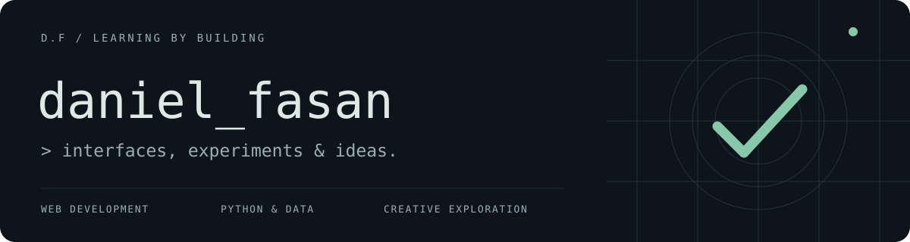

  

   <a href="https://danielfasan.vercel.app/">Portfolio</a>
  <a href="https://www.linkedin.com/in/daniel-fasan-a0b503331/">LinkedIn</a>

## A little about me

I’m Daniel, a **T-Level Digital Software Development student** at EKC Canterbury College. I enjoy designing interfaces, troubleshooting problems and turning ideas into things you can use.

Right now, I’m learning **React, TypeScript and JavaScript**, while developing my **HTML, CSS, Python and Flask** skills. I’m also interested in data, UI/UX and cybersecurity.

## Selected projects

| Project | What I’m building |
| :--- | :--- |
| **[Daniel’s Gallery](https://github.com/daniel-FDO/gallery)** | An interactive digital exhibition with generative art, visual studies and an optional ambient soundtrack. [Visit the gallery ↗](https://gallery-zeta-blond.vercel.app/) |
| **[React Dashboard](https://github.com/daniel-FDO/react-dashboard)** | A learning project using React, TypeScript and Vite to practise components and interface layouts. |
| **[Bridge Collective](https://github.com/daniel-FDO/Bridge-Collective)** | A Frontend Mentor landing-page exercise, exploring HTML, CSS and grid layouts. |
| **[Rock, Paper, Scissors](https://github.com/daniel-FDO/rock-paper-scissors-)** | A browser game built from a Frontend Mentor challenge, with score tracking and a rules panel. |

## My toolkit

**Web** &nbsp; HTML · CSS · Tailwind CSS  
**Python & data** &nbsp; Python · Flask · Pandas · SQL  
**Tools** &nbsp; Git · GitHub · VS Code · Chrome DevTools  
**Currently learning** &nbsp; JavaScript · React · TypeScript

---

Outside of code: Liverpool FC, music, gaming and cars. Always curious about what I can build next.
